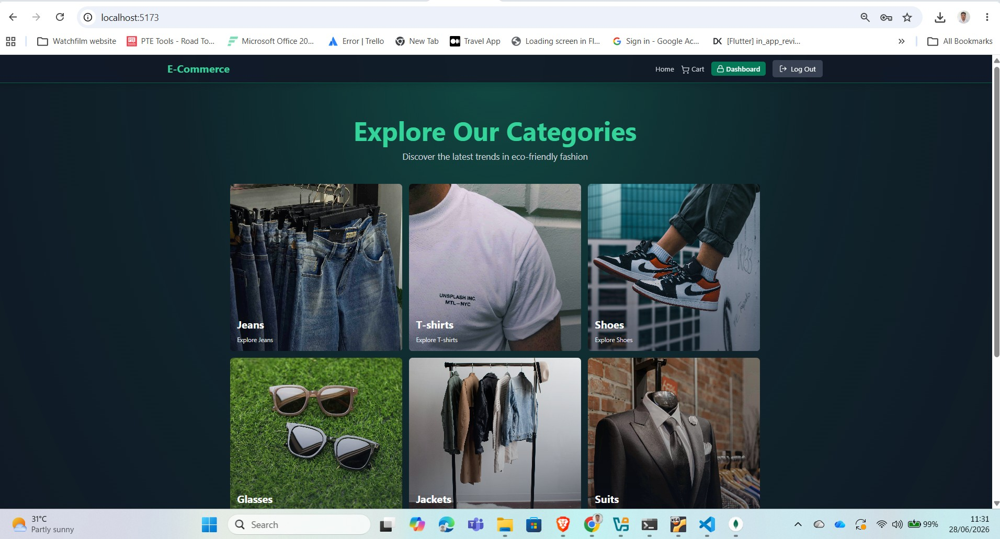

<h1 align="center">E-Commerce Store 🛒</h1>



About This Course:

- 🚀 Project Setup
- 🗄️ MongoDB & Redis Integration
- 💳 Stripe Payment Setup
- 🔐 Robust Authentication System
- 🔑 JWT with Refresh/Access Tokens
- 📝 User Signup & Login
- 🛒 E-Commerce Core
- 📦 Product & Category Management
- 🛍️ Shopping Cart Functionality
- 💰 Checkout with Stripe
- 🏷️ Coupon Code System
- 👑 Admin Dashboard
- 📊 Sales Analytics
- 🎨 Design with Tailwind
- 🛒 Cart & Checkout Process
- 🔒 Security
- 🛡️ Data Protection
- 🚀Caching with Redis
- ⌛ And a lot more...

### Setup backend environment

Create `backend/.env` with the values below. MongoDB and Redis must be running locally or you can use hosted services. Stripe and Cloudinary credentials are needed for their related features.

```bash
PORT=5000
MONGO_URI=your_mongo_uri

UPSTASH_REDIS_URL=your_redis_url

ACCESS_TOKEN_SECRET=your_access_token_secret
REFRESH_TOKEN_SECRET=your_refresh_token_secret

CLOUDINARY_CLOUD_NAME=your_cloud_name
CLOUDINARY_API_KEY=your_api_key
CLOUDINARY_API_SECRET=your_api_secret

STRIPE_SECRET_KEY=your_stripe_secret_key
CLIENT_URL=http://localhost:5173
NODE_ENV=development
```

### Run this app locally

Install Node.js, then from the project folder install dependencies:

```bash
npm install
npm install --prefix backend
npm install --prefix frontend
```

Create `frontend/.env` and add your Stripe publishable key if you want to use checkout:

```env
VITE_STRIPE_PUBLISHABLE_KEY=your_stripe_publishable_key
```

Start backend and frontend together in development mode:

```bash
npm run dev
```

Open `http://localhost:5173`. The backend runs at `http://localhost:5000`.

To start only one part, run `npm run dev --prefix backend` or `npm run dev --prefix frontend` in separate terminals. For a production frontend build, run `npm run build --prefix frontend`; to serve the built frontend from the backend, set `NODE_ENV=production` and run `npm run start --prefix backend`.

### DevOps infrastructure

See [docs/DEPLOYMENT.md](docs/DEPLOYMENT.md) for Docker Compose, Vagrant, Ansible, Terraform, Kubernetes, Jenkins, backup/migration, and monitoring setup.
```
